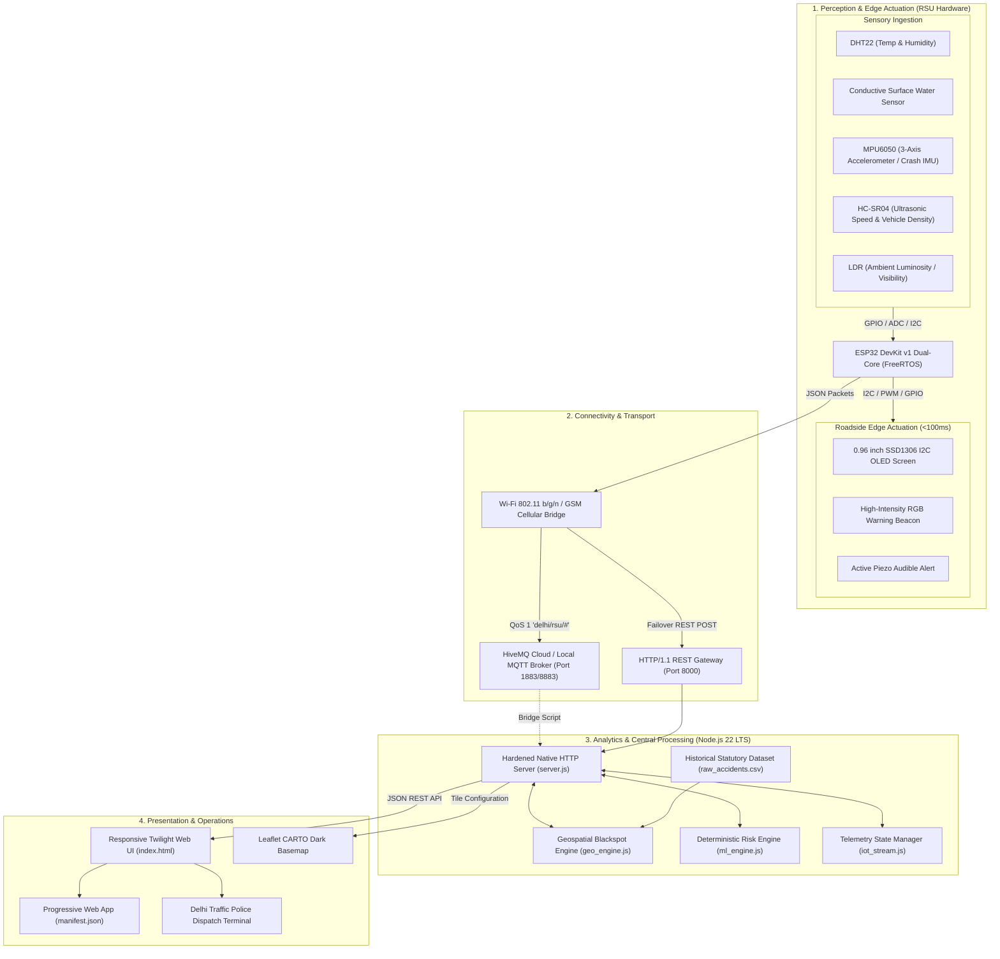
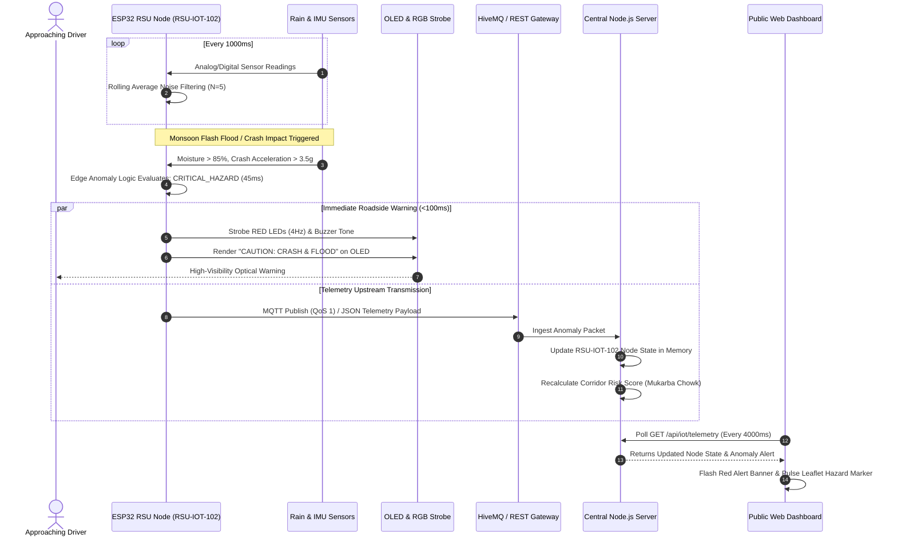

# System Architecture & Technical Design

## IoT-Enabled Road Safety & Blackspot Warning Platform
**Document Version**: 1.0 (September 2026)  
**Standard**: HCLTech Embedded Systems & IoT Capstone Design Specification  

---

## 1. High-Level System Architecture

The platform follows a **4-tier Cyber-Physical System Architecture**:
1. **Perception & Edge Actuation Tier**: Roadside Units (RSUs) equipped with microclimate, speed, and vibration sensors deployed at designated highway blackspots.
2. **Connectivity & Transport Tier**: MQTT publish-subscribe messaging over HiveMQ broker and fallback HTTP/1.1 REST transport over 802.11 b/g/n Wi-Fi / 4G cellular bridge.
3. **Analytics & Central Processing Tier**: Zero-dependency Node.js 22 LTS server housing the Geospatial Spatial Cluster Engine and deterministic Multi-Factor Risk Engine.
4. **Presentation & Operational Tier**: Responsive Progressive Web App (PWA) with Leaflet CARTO dark-mode mapping, 1-click scenario simulation, and live roadside telemetry feeds.

---

## 2. End-to-End Data Flow Sequence

The sequence diagram below illustrates the exact lifecycle of an edge hazard event (e.g. sudden monsoon water accumulation and high crash impact at *Mukarba Chowk*):

---

## 3. Technology Stack Breakdown

| Layer | Component | Technologies Used | Key Design Decision |
| :--- | :--- | :--- | :--- |
| **Embedded Edge** | Microcontroller | ESP32 DevKit v1 (Xtensa Dual-Core 240MHz) | Low cost, built-in Wi-Fi/BLE, hardware I2C/PWM, FreeRTOS support. |
| **Firmware** | Language & Framework | C++ (Arduino Core / VS Code PlatformIO) | Fast execution, hardware register access, deterministic interrupt handling. |
| **Sensors** | Physical Transducers | DHT22, Rain Foil Sensor, MPU6050, HC-SR04, LDR | High signal reliability, low component cost, well-documented Arduino drivers. |
| **Edge Actuators** | Local Signaling | 0.96" I2C SSD1306 OLED, Common Cathode RGB LED, Active Buzzer | Instant driver warning without needing phone or cellular data reception. |
| **Transport** | IoT Messaging | MQTT v3.1.1 (HiveMQ) + HTTP/1.1 REST Fallback | Lightweight packet headers (2 bytes), low bandwidth, robust under packet drops. |
| **Backend Core** | Server Runtime | Node.js 22 LTS Standard Libraries (`http`, `fs`, `path`, `url`) | **Zero external npm dependencies**; lightning-fast boot and zero supply chain vulnerability. |
| **Geospatial** | Spatial Binning & GeoJSON | Custom Haversine Grid Cluster Engine (`geo_engine.js`) | Sub-millisecond cluster assignment mapped to 55 official Delhi Traffic Police blackspots. |
| **Machine Learning**| Risk Scoring | Deterministic Multi-Factor Heuristic Classifier (`ml_engine.js`) | Transparent, explainable weights without black-box drift; bounded output $[0, 100]$. |
| **Frontend UI** | Dashboard & Maps | HTML5, CSS3 Glassmorphism, Leaflet.js, CARTO Dark Vector Tiles | Minimal twilight aesthetic reducing night eye fatigue; mobile-first PWA responsiveness. |

---

## 4. Edge-to-Cloud Anomaly Classification Matrix

The ESP32 firmware executes the following edge decision matrix to classify road states:

| Road State | Moisture Sensor (%) | Vibration $a_{\text{net}}$ (g) | Ambient Visibility (m) | OLED Display Text | RGB Beacon State | MQTT Anomaly Flag |
| :--- | :--- | :--- | :--- | :--- | :--- | :--- |
| **Normal Traffic** | $< 30\%$ | $< 1.2\text{g}$ | $> 500\text{m}$ | `ROAD CLEAR: SAFE SPEED` | Solid Green | `"normal"` |
| **Wet Road Surface** | $30\% - 75\%$ | $< 1.5\text{g}$ | $> 300\text{m}$ | `WET SURFACE: REDUCE SPEED` | Solid Amber | `"wet_surface"` |
| **Flash Flood / Waterlogged**| $> 75\%$ | $< 2.0\text{g}$ | Any | `DANGER: WATERLOGGED ROAD` | Pulsing Amber (2Hz)| `"flash_flood"` |
| **Severe Fog Bank** | $> 90\%$ | $< 1.2\text{g}$ | $< 150\text{m}$ | `ZERO VISIBILITY: USE FOG LIGHTS` | Slow Amber (1Hz)| `"fog_bank"` |
| **Vehicular Collision / Impact**| Any | $> 3.5\text{g}$ | Any | `CRITICAL ACCIDENT: STOP` | Rapid Red (4Hz) + Siren | `"crash_impact"` |
| **Sensor Disconnect / Error** | Open Circuit | No I2C ACK | Open Circuit | `SYS FAULT: PROCEED WITH CARE` | Alternating Red/Amber | `"sensor_fault"` |

---

## 5. Security Architecture

1. **Edge Protection**: ESP32 firmware contains no hardcoded Wi-Fi or broker passwords in Git repositories; credentials are injected via `secrets.h` or serial provisioning.
2. **Rate Limiting**: Central server protects against Denial-of-Service (DoS) and sensor flooding using an in-memory sliding window rate limiter (120 req/min per IP).
3. **HTTP Security Headers**:
   - `Content-Security-Policy`: Restricts scripts and styles to trusted CDNs (`unpkg.com`, `fonts.googleapis.com`).
   - `X-Frame-Options: DENY`: Prevents clickjacking attacks.
   - `X-Content-Type-Options: nosniff`: Mitigates MIME confusion vulnerabilities.
   - `Strict-Transport-Security`: Enforces encrypted transport when reverse-proxied over TLS.
