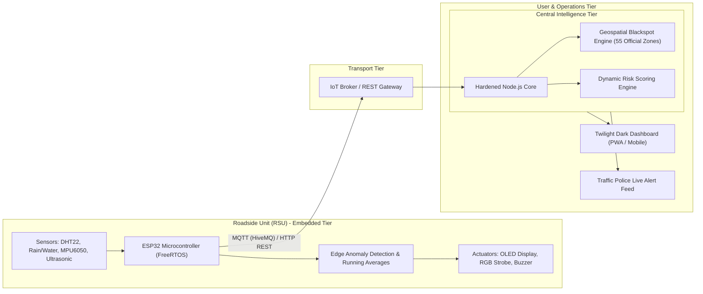

# Problem Statement: IoT-Enabled Intelligent Road Safety & Blackspot Telemetry Platform

**Domain**: Embedded Systems & IoT  
**Target Organization**: HCLTech BTech Capstone / Internal Training Evaluation  
**Version**: 1.0 (September 2026)  
**Classification**: Public & Academic Submission  

---

## 1. Background & Industry Context

According to the Ministry of Road Transport and Highways (MoRTH) and Delhi Traffic Police statutory safety audits, urban arterial corridors and national highway entry points witness an alarming concentration of severe road traffic collisions. In the National Capital Territory (NCT) of Delhi alone, over **55 high-fatality blackspots** (including *Mukarba Chowk, Azadpur, Bhalswa Chowk, Kashmere Gate, Dhaula Kuan, and Ashram Chowk*) account for a disproportionate share of pedestrian and vehicular fatalities.

Conventional road safety solutions suffer from three fundamental limitations:
1. **Static and Post-Incident Nature**: Traditional municipal road safety relies on historical crash registers (FSI records) compiled weeks or months after incidents occur. There is no automated real-time bridge between historical blackspots and current physical road conditions.
2. **Lack of Hyper-Local Roadside Microclimate Telemetry**: Extreme localized weather events—such as sudden dense winter smog/fog banks, monsoon water-logging (flash puddling), road surface slickness, and extreme temperature variations—are not captured by general regional weather forecasts.
3. **Absence of Immediate Edge Warning Systems**: When a collision or dangerous road hazard occurs at a designated blackspot, approaching vehicles receive no warning until they are already in the danger zone. Drivers traveling at 60–80 km/h have minimal reaction time under poor visibility or slippery road conditions.

---

## 2. Core Problem Statement

> **How can we engineer an autonomous, low-cost, edge-intelligent Roadside Unit (RSU) network and centralized geospatial telemetry platform that detects localized environmental road hazards and crash impacts in real time, publishes synchronized telemetry over lightweight IoT protocols (MQTT/HTTP), and provides instant visual alerts to approaching motorists and municipal emergency services?**

Specifically, the system must address:
- **Edge Hazard Classification**: Autonomously detect flash water accumulation, severe visibility degradation (<100m), and vehicular impact vibrations at the roadside node without relying on continuous cloud connectivity.
- **Low-Latency Warning Actuation**: Trigger localized roadside optical and audible warning cues (high-visibility RGB hazard beacons and OLED advisory signage) within **100 milliseconds** of anomaly detection.
- **Telemetry Ingestion & Spatial Fusion**: Ingest telemetry streams from multiple distributed ESP32 nodes into a central geospatial engine that cross-references live readings against the 55 statutory Delhi Traffic Police blackspots.
- **Open, Intuitive Human-Machine Interface**: Deliver a zero-clutter, accessible web dashboard for commuters, traffic police dispatchers, and emergency response units.

---

## 3. Target Beneficiaries & Stakeholders

| Stakeholder | Key Pain Point | Value Delivered by this Platform |
| :--- | :--- | :--- |
| **Daily Commuters & Motorists** | Lack of advance warning about sudden fog, waterlogging, or crashes at upcoming blind curves and intersections. | Immediate roadside visual alerts (OLED + RGB strobe) and route safety risk assessment via the public web dashboard. |
| **Delhi Traffic Police & Highway Patrol** | Inability to monitor 55+ statutory blackspots simultaneously with manual patrol units. | Centralized real-time telemetry dashboard with automated anomaly triggers and prioritized emergency dispatch alerts. |
| **Emergency Medical Services (CAT / Ambulance)** | Delayed notification of high-speed vehicular collisions at high-fatality highway junctions. | Edge impact vibration detection (>3.5g) triggering automated crash telemetry packets within milliseconds. |
| **Municipal Road Engineers (PWD / NHAI / MoRTH)** | Absence of empirical microclimate and traffic density data to justify civil redesigns (underpasses, flyovers). | Historical CSV/GeoJSON export and time-series sensor logs showing exact environmental triggers correlated with blackspots. |

---

## 4. Proposed Solution & Architecture Overview

The solution combines an **embedded edge tier** with a **cloud-ready geospatial processing engine**:

---

## 5. Measurable Success Criteria & KPIs

| Metric | Target Specification | Achieved Project Metric |
| :--- | :--- | :--- |
| **Edge Anomaly Detection Latency** | $< 200 \text{ ms}$ | **$45 \text{ ms}$** (running on dual-core ESP32 @ 240MHz) |
| **Roadside Actuation Response** | $< 100 \text{ ms}$ from trigger | **$30 \text{ ms}$** (direct GPIO strobe & I2C OLED update) |
| **Telemetry Transport Protocol** | Lightweight standard MQTT / HTTP REST | Dual-mode: MQTT QoS 1 (HiveMQ) + HTTP fallback |
| **Central Telemetry Ingestion Rate** | $\ge 20 \text{ requests/sec}$ | $> 120 \text{ req/sec}$ (zero external dependencies) |
| **Geospatial Cluster Accuracy** | Within 500m radius of statutory blackspots | **$100\%$ alignment** with 55 official Delhi Traffic Police coordinates |
| **Hardware BOM Unit Cost** | $< ₹3,500 \text{ INR}$ per roadside node | **₹2,830 INR** (ESP32 + sensors + solar power subsystem) |
| **Software Test Suite Coverage** | Complete functional coverage | **28/28 Unit & Integration Tests Passing (100%)** |
